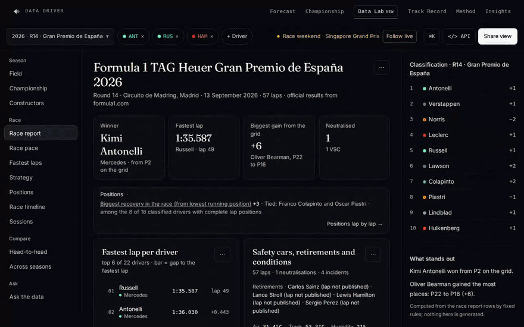
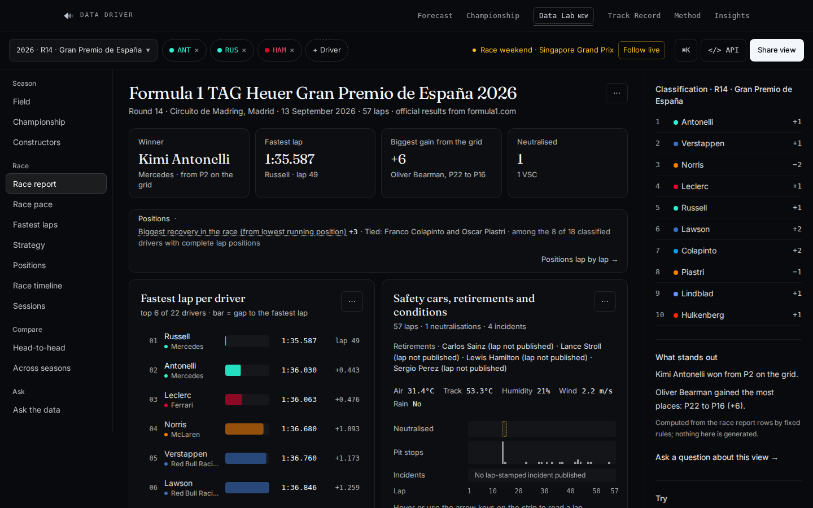
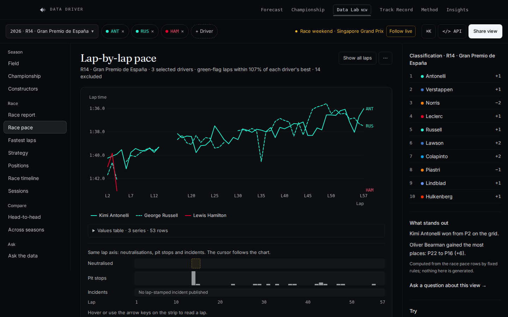
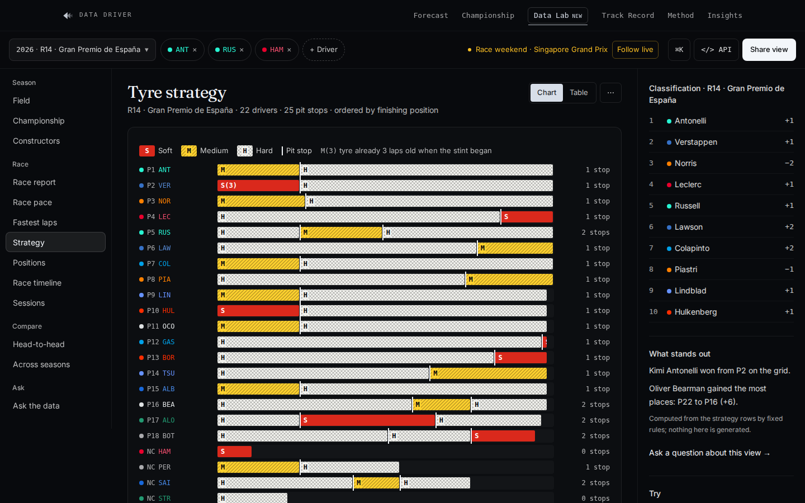
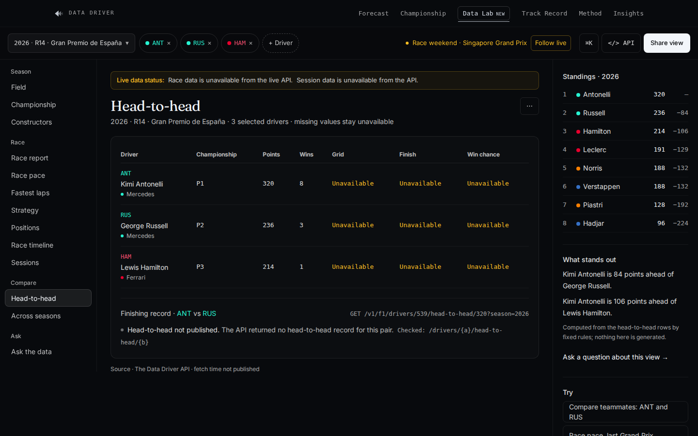
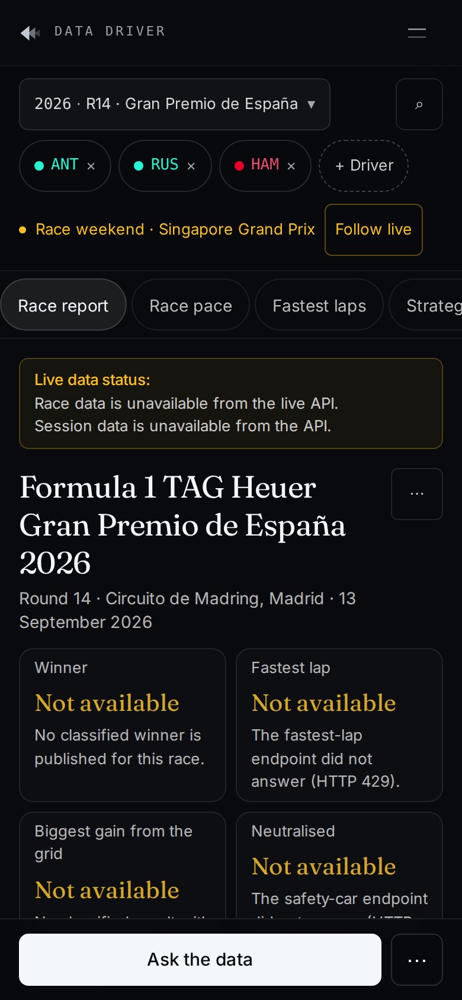

<div align="center">


# The Data Driver — Data Lab

**Explore, compare and export Formula 1 data in your browser. Every number has a source.**

[**Open the live Lab**](https://thedatadriver.app/lab) ·
[Run it locally](#quick-start) ·
[Use it from Claude or ChatGPT](#use-it-from-claude-or-chatgpt) ·
[API reference](docs/API.md)

[](https://github.com/thejoyfulist/the-data-driver-lab/actions/workflows/ci.yml)
[](https://github.com/thejoyfulist/the-data-driver-lab/releases)
[](LICENSE)
[](#data-licences)
[](https://nextjs.org)
[](docs/MCP.md)
[](CONTRIBUTING.md)



</div>

Pick a race, change the lens, compare the field. The Data Lab is the open-source analysis workspace of
[The Data Driver](https://thedatadriver.app): race reports, lap-by-lap pace, tyre strategy, positions,
championship progression and head-to-heads, all drawn from a free public API. Each view shows the request
behind it and can be exported. **Unavailable data stays unavailable — nothing is guessed or back-filled.**

## Why the Data Lab

- **Every number has a source.** Each view states its provenance (official results or attributed OpenF1
  enrichment), its fetch time and the exact `GET` request. Export any view as CSV or JSON.
- **No invented figures.** Missing laps are not interpolated and a prediction never stands in for a result.
  "What stands out" sentences are computed by fixed rules from the rows on screen, never generated.
- **Built for analysis.** One view at a time, a shared chart cursor, a values table behind every chart,
  `⌘K` command palette, shareable URLs, and a mobile layout that puts the first chart on the first screen.
- **Your AI, your key.** Ask questions with Anthropic, OpenAI, OpenRouter, Groq, a local Ollama or any
  OpenAI-compatible endpoint. The model can only answer from read-only F1 tools and shows every call.
- **Plugs into your assistant.** A public, read-only [MCP](https://modelcontextprotocol.io) server gives
  Claude, ChatGPT and other clients 19 F1 tools plus `search` and `fetch`, with sources in every answer.
- **Small and hackable.** Next.js 16, React 19, charts in plain SVG (no chart library), pure tested
  analytics functions, and end-to-end tests against a local mock API.

## Views

| Race report | Lap-by-lap pace |
| --- | --- |
| [](https://thedatadriver.app/lab?view=report&season=2026&round=16) | [](https://thedatadriver.app/lab?view=pace&season=2026&round=16) |
| **Tyre strategy** | **Head-to-head** |
| [](https://thedatadriver.app/lab?view=strategy&season=2026&round=16) | [](https://thedatadriver.app/lab?view=h2h&season=2026&round=16) |

<details>
<summary><b>All views and features</b></summary>

- **Season**: field, championship progression, constructors.
- **Race**: race report (the default view), race pace, fastest laps, tyre strategy, positions lap by lap,
  race timeline (safety cars, retirements, weather), sessions.
- **Compare**: head-to-head and across seasons. **Ask**: grounded questions, or the optional AI mode.
- **Race report**: official name, venue, date and laps, four key figures computed from the API (winner,
  fastest lap, biggest grid-to-finish gain, neutralisations), then fastest laps, the timeline, the
  championship after the race and its progression.
- **Charts**: a cursor shared by the charts on the same axis (hover or arrow keys) with a values tooltip,
  end-of-line labels that never overlap, a clickable legend and dashed lines for teammates.
- **Shareable state**: the URL carries the view, season, round and selection; Back and Forward move
  between views.
- **Keyboard first**: `⌘K` / `Ctrl+K` command palette, `/` to search the field, `[` `]` to step through races.
- **Works without JavaScript** for the default view: the server renders the race report.
- **Honest empty states**: when an endpoint is unavailable, the view says so in one line with the reason.

<p align="center"></p>

</details>

<sub>Screenshots taken against the live public API. Lap times and tyre data are non-official OpenF1 enrichment
(CC BY-NC-SA 4.0), attributed in each view.</sub>

## Quick start

Requirements: Node.js 20.9 or later (22 LTS recommended) and npm.

```bash
git clone https://github.com/thejoyfulist/the-data-driver-lab.git
cd the-data-driver-lab
npm install
npm run dev
```

Open <http://localhost:3000>. The Lab reads the public API at `https://api.thedatadriver.app` by default:
no key or account is needed.

With Docker:

```bash
docker compose up --build
```

Or deploy your own copy:

[](https://vercel.com/new/clone?repository-url=https%3A%2F%2Fgithub.com%2Fthejoyfulist%2Fthe-data-driver-lab&project-name=the-data-driver-lab&repository-name=the-data-driver-lab)

More options (production build, Docker without Compose, environment variables) are in
[docs/INSTALL.md](docs/INSTALL.md).

## Use it from Claude or ChatGPT

The hosted MCP endpoint is public and read-only: `https://thedatadriver.app/api/mcp`. In Claude Code:

```bash
claude mcp add --transport http the-data-driver https://thedatadriver.app/api/mcp
```

Then ask, for example, *"Who gained the most places from the grid at the 2026 Spanish Grand Prix? Cite the
source."* Claude.ai, ChatGPT and a local stdio server (`npm run mcp:stdio`) are covered in
[docs/MCP.md](docs/MCP.md).

## AI mode (your own key)

"Ask the data" keeps its deterministic grounded endpoint as the default. **AI — your own key** is an
optional second mode:

- **Providers**: Anthropic, OpenAI, OpenRouter, Groq, Ollama (local) and any OpenAI-compatible endpoint,
  through the [Vercel AI SDK](https://ai-sdk.dev). The model name is free text.
- **Key safety**: requests go from your browser straight to the provider, never through The Data Driver
  or the `/api/f1` proxy. The key is kept in `sessionStorage` (this tab only) unless you tick
  "Remember on this device"; "Forget key" stops a running question and removes it. Endpoints on a
  `thedatadriver.app` host are refused whatever their spelling (case, trailing dot, `%2e`, IDNA), and the
  enforced CSP lets the page reach only the listed providers, a local Ollama and the origins you add in
  `NEXT_PUBLIC_TDD_AI_CONNECT_SRC`.
- **Grounding**: the model may answer only from the results of read-only F1 tools over the public API,
  must say "not available" otherwise, and cites its sources. At most 8 tool steps per question.
- **Ollama**: allow the Lab's origin with `OLLAMA_ORIGINS` (CORS), e.g.
  `OLLAMA_ORIGINS="https://thedatadriver.app" ollama serve`.
- **Evaluation bench**: about fifty frozen questions graded on meaning. A run passes only with no wrong
  answer and at least 90 % exact answers; a mock mode runs in CI (`npm run eval:ai -- --mode mock`).

Details, CORS for other servers and the tool catalogue: [docs/AI.md](docs/AI.md).

## Configuration

| Variable | Read at | Default | Purpose |
| --- | --- | --- | --- |
| `TDD_API_BASE` | runtime (server) | `https://api.thedatadriver.app` | Upstream API used by the server page and the `/api/f1` proxy. |
| `TDD_API_SERVER_KEY` | runtime (server) | none | Optional API key sent upstream by the `/api/f1` proxy and the MCP endpoint. Not needed for the public API. |
| `NEXT_PUBLIC_TDD_API_BASE` | build time | `https://api.thedatadriver.app` | Origin shown in "copy API request" and allowed by the CSP. Also used by the server when `TDD_API_BASE` is unset. |
| `NEXT_PUBLIC_TDD_REPO_URL` | build time | this repository | "Source" link in the header and footer. |
| `NEXT_PUBLIC_TDD_AI_CONNECT_SRC` | build time | none | Extra origins (space-separated) the CSP and the AI settings form allow, e.g. your own OpenAI-compatible endpoint or Ollama on another port. HTTPS only (HTTP for the local machine); a `thedatadriver.app` host fails the build. |

Copy `.env.example` to `.env.local` to override them locally.

## Architecture

```
Browser ──► Next.js app (this repository)
              ├─ /            Server component: fetches the default race, renders it (ISR, 5 min)
              │               then hydrates the client Lab (React 19)
              ├─ /api/f1/...  Same-origin proxy with a path allow-list ──► TDD_API_BASE/v1/f1/...
              └─ /api/mcp     Read-only MCP server (Streamable HTTP, stateless)
```

<details>
<summary><b>Where things live</b></summary>

- `src/app/page.tsx` — server entry: calendar, standings, the last completed race and its views' seed.
- `src/app/LabPageClient.tsx` — workspace state (view, race, drivers) in the URL, field, sessions,
  head-to-head and grounded questions.
- `src/components/lab/` — the workspace chrome (`LabWorkspace`), race report (`RaceReportView`), inspector
  (`LabInspector`), the analytical views (`LabViews`, `SeasonViews`), charts (SVG, no chart library), lazy
  loading, command palette and the shared resource cache (`useLabResource`).
- `src/lib/lab-workspace.mjs` — the view registry and the session status helpers; `src/lib/lab-insights.mjs` —
  the race report's key figures and the inspector's sentences, pure and tested.
- `src/lib/lab-client.ts` — typed, all-optional payload shapes, the browser fetch helper and exports.
- `src/lib/lab-analytics.ts` — pure functions (green-flag pace filter, stints, championship progression…).
- `src/lib/proxy-allowlist.mjs` — the read endpoints the proxy forwards; everything else answers 404.
- `src/lib/team-colors.ts` — team colours as plain hex values (no logos or other team assets).
- `src/lib/f1-tools/` — the read-only F1 tool catalogue (inputs as Zod / JSON Schema, bounded JSON outputs
  with source and licence), shared by the MCP server, the AI mode and the evaluation bench.
- `src/lib/ai-byok/` and `src/components/lab/AskAiPanel.tsx` — the optional AI mode (providers, key storage,
  the tool loop), loaded only when it is opened.

The browser talks to its own origin. The proxy forwards the allow-listed `GET` endpoints and a single
`POST` (`/v1/f1/chat`, the grounded question endpoint) with an 8 KB body limit. The only exception is the
AI mode, where the browser calls the provider you chose directly.

</details>

## Contributing

Bug reports, new views, accessibility fixes and documentation are all welcome. Issues labelled
[`good first issue`](https://github.com/thejoyfulist/the-data-driver-lab/labels/good%20first%20issue) are a
good place to start; read [CONTRIBUTING.md](CONTRIBUTING.md) before opening a pull request.

```bash
npm run lint        # ESLint (eslint-config-next)
npm run typecheck   # tsc --noEmit
npm test            # unit tests (node:test) and the AI bench in mock mode
npm run test:e2e    # Playwright against a local mock API (npx playwright install chromium first)
npm run build       # production build
```

If a figure looks wrong, use **Copy API request** in the view and open a
[data issue](https://github.com/thejoyfulist/the-data-driver-lab/issues/new?template=data_issue.yml) with
the official source.

## Data licences

**The code in this repository is MIT-licensed. The data it displays is not**: it stays under the licence of
its source, and anything you build or publish with it must respect those terms.

| Data | Source | Terms |
| --- | --- | --- |
| Results, qualifying, standings, calendar | [formula1.com](https://www.formula1.com), projected by The Data Driver API | Official classifications, used with attribution. Check formula1.com's terms before any reuse beyond personal analysis. |
| Laps, stints, pit stops, weather, race control, telemetry | [OpenF1](https://openf1.org) historical API, via The Data Driver API | [CC BY-NC-SA 4.0](https://creativecommons.org/licenses/by-nc-sa/4.0/): **non-commercial use only, attribution required, adaptations shared under the same licence.** The API marks every such payload (`meta.license`, `meta.attribution`) and the Lab labels it as non-official enrichment. |
| Forecasts | The Data Driver model | Published for non-commercial use; see the [methodology](https://thedatadriver.app/methodology). |

The Data Driver API is free and non-commercial; rate limits apply. Please do not use this application to
scrape it — use the API directly and cache responsibly (see [docs/API.md](docs/API.md)).

### Not affiliated with Formula 1

This project is unofficial and is not associated in any way with the Formula 1 companies. F1, FORMULA ONE,
FORMULA 1, FIA FORMULA ONE WORLD CHAMPIONSHIP, GRAND PRIX and related marks are trade marks of Formula One
Licensing B.V. Team and driver names are used only to identify the data. The repository contains no team
logos, driver photographs or other third-party assets: teams are identified by a colour swatch.

The bundled fonts (Fraunces, Inter) are distributed under the SIL Open Font License 1.1 (`public/fonts/OFL-*.txt`).
The Data Driver name and logo mark identify the original project; please do not present a fork as the
official The Data Driver site.

## Licence

[MIT](LICENSE) for the code. Data: see [Data licences](#data-licences).

<div align="center"><sub>If the Lab helps you, a ⭐ helps other F1 data fans find it.</sub></div>
